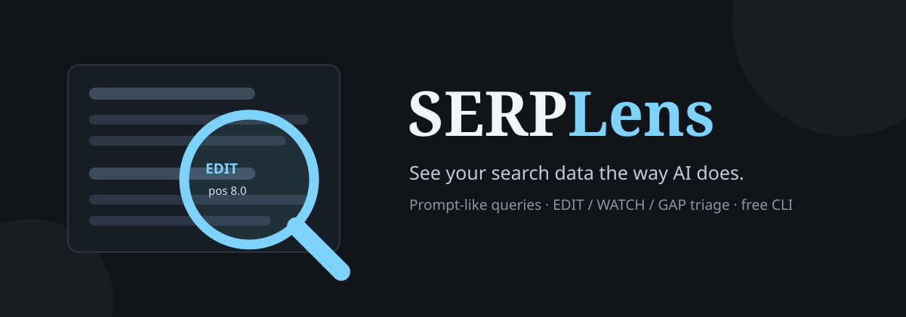
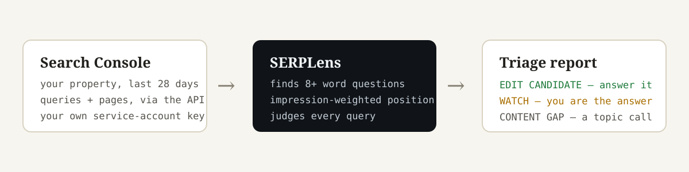

<p align="center">
  
</p>

<p align="center">
  <a href="https://github.com/iSahinul/SERPLens/releases"></a>
  <a href="https://github.com/iSahinul/SERPLens/stargazers"></a>
  <a href="LICENSE"></a>
  
  
  
</p>

<p align="center">
  <a href="#quick-start">Quick start</a> · <a href="#how-it-works">How it works</a> · <a href="#the-verdicts">The verdicts</a> · <a href="#setup">Setup</a> · <a href="#faq">FAQ</a>
</p>

**SERPLens is a free, open-source CLI toolkit that reads your Google Search Console data through an AEO lens.** Dashboards show you numbers; SERPLens tells you what to do. Its first tool, `prompt-scan`, finds the long, question-shaped queries your site already appears for — the same shape as the prompts people type into AI search — and gives every one a verdict: edit this page, watch this one, or treat this as a new-topic decision.

<p align="center">
  
</p>
<p align="center"><em>Your Search Console data in — a short list of decisions out.</em></p>

## Quick start

```bash
git clone https://github.com/iSahinul/SERPLens.git
cd SERPLens
pip install -r requirements.txt

python -m serplens prompt-scan \
  --property https://example.com/ \
  --credentials /path/to/service-account.json
```

You get a summary in the terminal and a dated markdown report like:

| Verdict | Query | Imp | Clicks | Pos | Top page |
|---|---|---|---|---|---|
| EDIT CANDIDATE | how do i fix a leaking tap at home | 150 | 2 | 8.0 | /guides/fix-leaking-tap |
| WATCH | what is the best way to descale kettles | 40 | 0 | 2.0 | /guides/descale-kettle |
| CONTENT GAP | why does my washing machine smell so bad lately | 10 | 0 | 25.0 | /laundry/washer-smells |

See a full report before connecting anything: [examples/sample-output.md](examples/sample-output.md) (generated from synthetic data).

## How it works

Long queries (8+ words) in Search Console are usually real questions — typed or spoken in full sentences. Those are exactly the queries AI search engines answer. If you already appear for one but earn few clicks, the cheapest fix in SEO is often a 40–60 word direct answer near the top of the page that already ranks.

`prompt-scan` pulls the last 28 days of query+page data from the official Search Console API, aggregates each query (impression-weighted position, top page), keeps the prompt-like ones (8+ words, 5+ impressions), and judges each. It also lists **proven demand** — question-word or 5+ word queries with 3+ impressions — the questions your own data proves people ask, ready to feed your next article's research.

## The verdicts

- **EDIT CANDIDATE** (position 3.5–20) — ranking but not winning. Add the direct answer; repeat the question in the page's FAQ if it has one.
- **WATCH** (position ≤ 3.5, 0 clicks) — you likely *are* the answer (snippet / AI overview absorption). Editing rarely helps; observe.
- **CONTENT GAP** (position > 20) — not really ranking. A topic decision, not an edit.

## Setup

SERPLens reads GSC with **your own** Google service-account key — nothing is sent anywhere else.

1. In [Google Cloud Console](https://console.cloud.google.com/), create (or pick) a project and enable the **Google Search Console API**.
2. Create a **service account**, then a **JSON key** for it. Download the key file and keep it out of git (the repo's `.gitignore` already blocks common key filenames).
3. In [Search Console](https://search.google.com/search-console), open your property → Settings → Users and permissions → add the service account's email as a user (Full or Restricted access both work).
4. Run the quick start with your property exactly as GSC shows it — `https://example.com/` for a URL-prefix property, `sc-domain:example.com` for a domain property.

## Give it to your AI

Paste this into Claude, ChatGPT or Codex and let your assistant do the setup:

```text
Set up SERPLens from this repo for my site. Read skill/SKILL.md first.
Help me create a Google Cloud service account, save the key OUTSIDE the
repo, then run a prompt scan for the last 28 days and explain the EDIT,
WATCH and GAP verdicts in plain words. Never paste the key's contents
anywhere, and never commit it.
```

## Use it as an agent skill

This repo ships a `SKILL.md` (in the `skill/` folder) in the open Agent Skills format — the same file works in Claude, ChatGPT and Codex. Install the skill and your AI assistant can run scans for you and explain the verdicts: copy the `skill/` folder into your agent's skills directory (for example `~/.claude/skills/serplens/` or `~/.agents/skills/serplens/`), keeping `SKILL.md` inside it.

## Roadmap

- **v0.1** — `prompt-scan` (this release)
- **v0.2** — cannibalization check: queries where two of your pages compete
- **v0.3** — quick-answer edit tracking: did the pages you edited gain clicks?
- Later — Core Web Vitals spot-checks, product-page audits

## FAQ

<details>
<summary><b>Is this affiliated with Google?</b></summary>

No. SERPLens is an independent open-source tool that uses the official Search Console API with your own credentials.
</details>

<details>
<summary><b>Does my data go anywhere?</b></summary>

No. The tool runs on your machine, calls Google's API with your key, and writes the report locally. There is no server, no analytics, no account.
</details>

<details>
<summary><b>Why 8+ words for "prompt-like"?</b></summary>

Short queries are keywords; 8+ word queries are almost always full questions — the shape of AI prompts and voice searches. That is the set where a direct-answer block changes outcomes.
</details>

<details>
<summary><b>Can I use OAuth instead of a service account?</b></summary>

Not in v0.1 — the service-account flow is the simplest to run unattended. OAuth support is a fair feature request; open an issue.
</details>

## What has been tested

The scan logic is covered by unit tests and was run end-to-end on synthetic Search Console data (see `examples/sample-output.md`). A live run needs your own service-account key, so the first live verification happens on your machine, against your property. The verdict thresholds themselves come from a production SEO audit system where this scan runs every month.

## About the creator

SERPLens comes out of running a small system of niche content sites and doing the same scan by hand every month as part of an SEO audit. The scan earned its keep — the toolkit is that system, one tool at a time, made public.

**Sahinul Islam Laskar** — SEO content writer & niche site operator · [GitHub](https://github.com/iSahinul) · [LinkedIn](https://www.linkedin.com/in/isahinul/) · [X (@iSahinul)](https://x.com/iSahinul)

---

<p align="center"><sub>© 2026 Sahinul Islam Laskar · SERPLens is free software under the MIT License.</sub></p>
